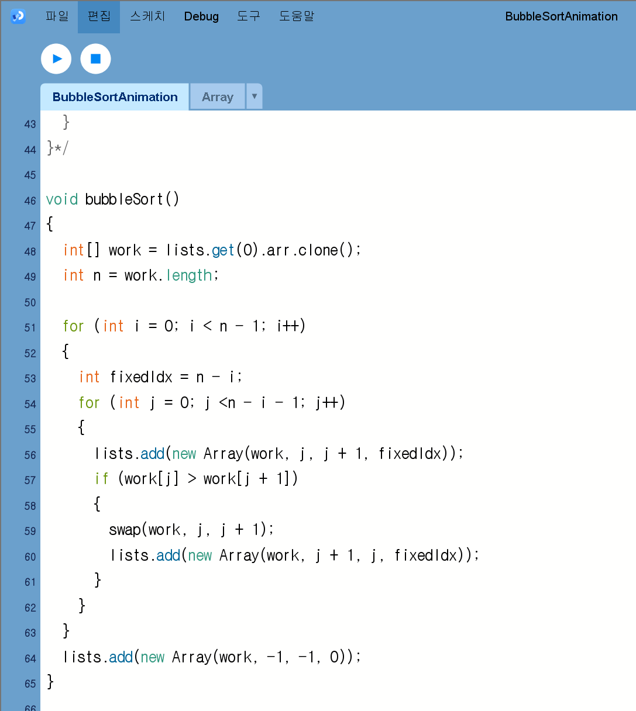
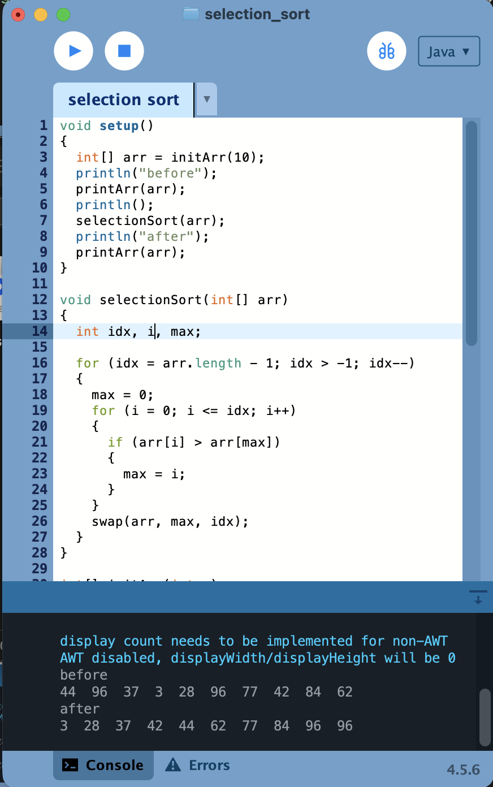
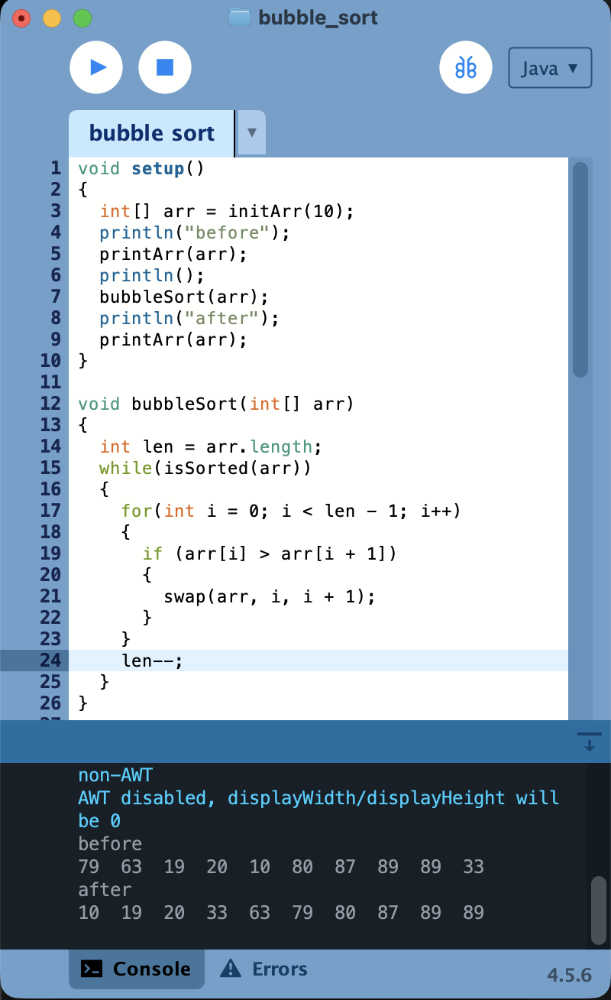
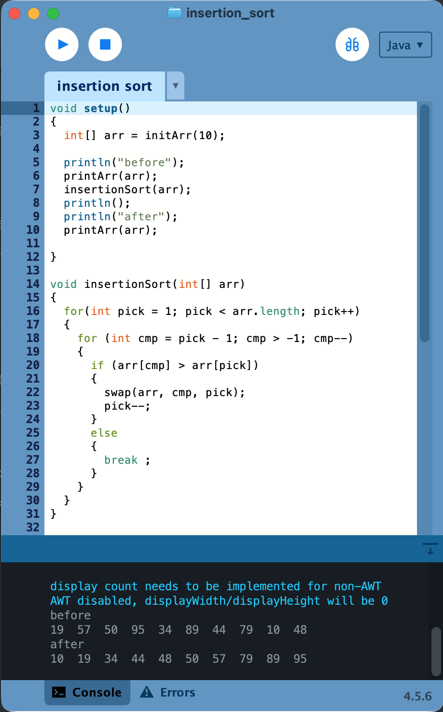
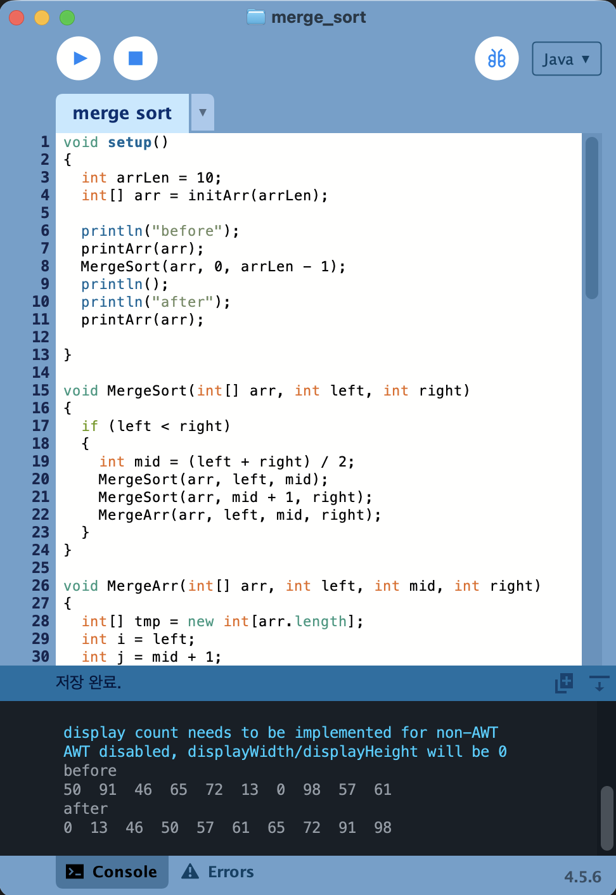
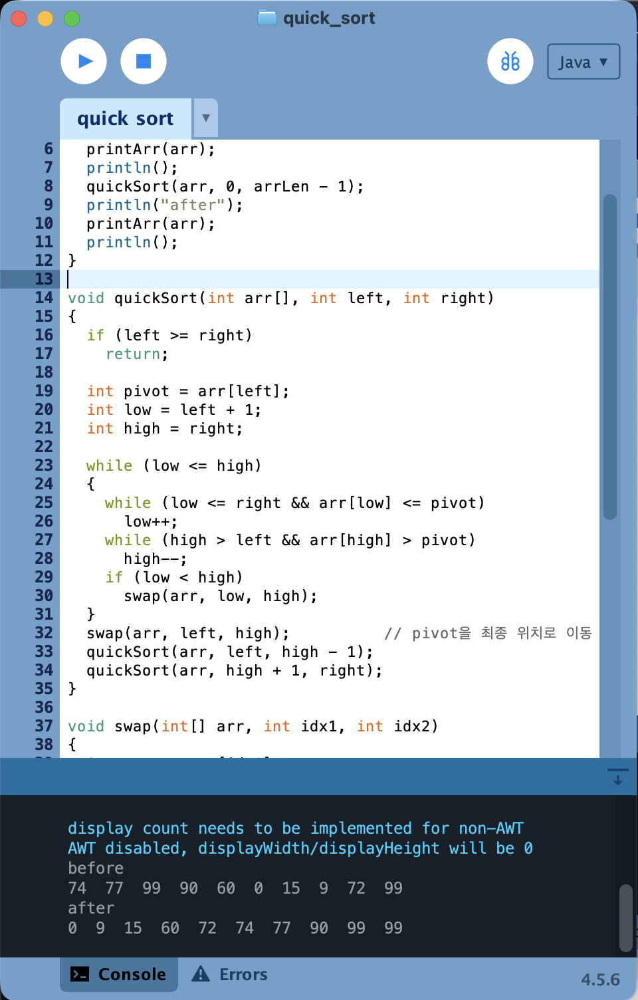
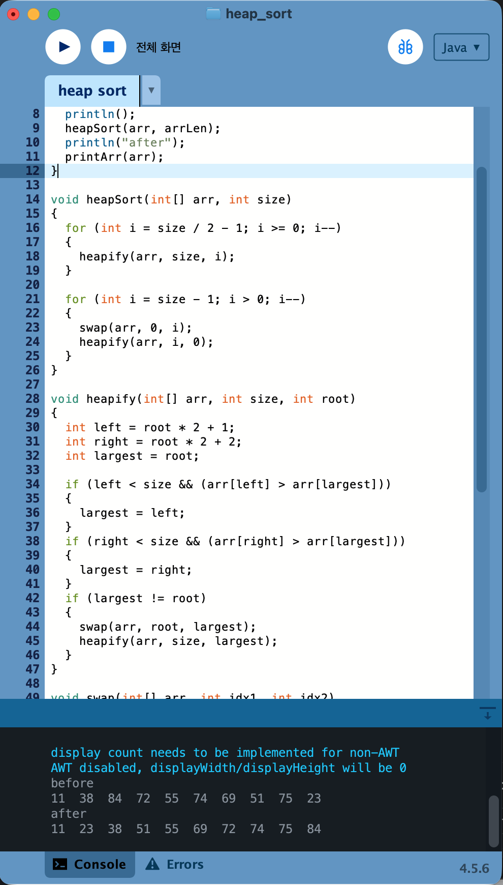

# algorithm_2026

### HOMEWORK2

[BubbleSortAnimation](./homework/BubbleSortAnimation/BubbleSortAnimation.pde)
 
[Array](./homework/BubbleSortAnimation/Array.pde)
 
[Youtube]()

### HOMEWORK1
[SelectionSorting](./homework/SelectionSort/selection_sort.pde)

 

[BubbleSorting](./homework/BubbleSort//bubble_sort.pde)

 

[InsertionSort](./homework/InsertionSort/insertion_sort.pde)

 

[MergeSort](./homework/MergeSort/merge_sort.pde)

 

[QuickSort](./homework/QuickSort/quick_sort.pde)

 

[HeapSort](./homework/HeapSort/heap_sort.pde)

